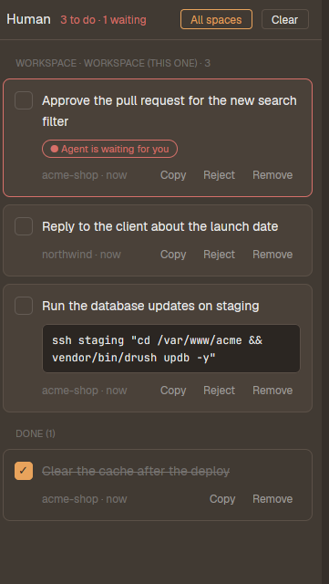

# Herdr Human

A [Herdr app](https://herdr.dev) mod that collects what your agents ask *you* to do into one
checklist. Agents register an instruction with `human-add`; you tick it off in a panel, copy
its command with a click, or reject it so the agent tries to do it itself.



The screenshot uses made-up tasks.

- One inbox for every space and tab. The header button narrows the list to the shown space.
- Click an instruction (or its command) to copy the command, or the text if it has none.
- Tick the box to check it off. Checked items move under *Done* and can be cleared.
- **Reject** sends the task back to the agent that created it (`hc send`). The agent is told
  to do it itself, and to register it again with `--retry '<why not>'` only if it can't.
  A retried item shows the agent's reason and has no reject button.
- An agent that can't continue until you're done registers the item with `--wait`. The card
  gets a red border and an "Agent is waiting for you" pill, the header counts how many wait,
  and checking the item off sends `Done by the human: ...` to the agent's terminal, so it
  can end its turn and wake up when you're done. Without `--wait` the agent gets no signal.
- Checked items fold their command away.

## How it works

Agents append one JSON line per instruction to `~/.config/herdr-app/human/inbox.jsonl`:

```json
{"id":"1795284398-9d7985ab","ts":"2026-11-21T19:00:00+01:00","project":"my-site","text":"Clear the cache","cmd":"ddev drush cr","terminal":"t7"}
```

The mod never edits that file. What you have checked off or removed is kept in
`~/.config/herdr-app/human/state.json`, so parallel agents can append without clashing.
`terminal` is the agent's `HC_TERMINAL_ID`; it is how *Reject* finds the agent.

## Install

Needs the Herdr desktop app and `jq` for `human-add` (`brew install jq` on macOS). Copying
uses `pbcopy` on macOS, and `wl-copy`, `xclip` or `xsel` on Linux. `~/.local/bin` must be on
your `PATH` for `human-add`, or install it somewhere that is.

```sh
git clone https://github.com/petertornstrand/herdr-app-human
cp -r herdr-app-human/mods/human ~/.config/herdr-app/mods/human
install -m 755 herdr-app-human/bin/human-add ~/.local/bin/human-add
install -m 755 herdr-app-human/bin/human-remove ~/.local/bin/human-remove
herdr-app check ~/.config/herdr-app/mods/human
```

Open it as a popup with `mod.open:human`, or as a side pane with
`herdr-app do pane.split --direction right --mod human`.

## A button and a column in your layout

Herdr's own layouts and tab bar are read-only, so clone them first
(`herdr-app do layout.clone '{"name":"main","as":"my-layout"}'` and
`herdr-app do mod.clone '{"name":"tabs","as":"my-tabs"}'`), point the layout's `tabs` block at
the cloned tab bar, then:

1. In the layout, add a hidden block as a sibling of the `panel` column inside `work-body`:

   ```json
   {
     "id": "human-panel",
     "type": "block",
     "hidden": true,
     "size": { "px": 360 },
     "min": 280,
     "max": 700,
     "content": { "mod": "human" }
   }
   ```

2. In the cloned tab bar, add a button after the panel buttons. It needs `find` (the
   tab bar's helper that looks up a layout node by id) and `run` from `herdr`:

   ```js
   .child((() => {
     const hp = find(root, "human-panel");
     const on = hp && !hp.hidden;
     return h_flex().id("panel-human").h(26).px(8).gap(5).flex_none().items_center().rounded(6)
       .text_size(12).bg(on ? t.selected : t.chrome).text_color(on ? t.foreground : t.muted)
       .hover(s => s.bg(t.hover))
       .on_click(() => run(on ? "layout.hide" : "layout.show", { id: "human-panel" }))
       .child(svg("mods/human/icon.svg").size(14)).child("Human");
   })())
   ```

The exact variable names depend on the tab bar you cloned; read it and adapt.

## Tell your agents

`human-add [--project NAME] [--cmd 'command to copy'] [--retry 'why the agent could not do it'] [--wait] 'text'`

Add something like this to the instructions your agents read (`CLAUDE.md`, `AGENTS.md`, or
whatever your agent tool uses). Without it, agents never call `human-add`. The panel's own
text is English, but the instruction text is whatever the agent writes: say "in Swedish" (or
your language) after "short instruction" if you want it that way.

```markdown
## Instructions to the human

Whenever you tell me to do something myself (run a command, check something in a browser,
change something on a server, reply to someone), also register it with `human-add` so it
shows up in the Human panel in Herdr. Do this in addition to writing it in chat.

- One call per separate action:
  `human-add --project <project> --cmd '<command>' '<short instruction>'`.
  `--cmd` is only for something I can copy and run as is.
- Keep the text to one line. Don't register things you only tell me for information.
- Add `--wait` only when you cannot continue until I've done it. Then end your turn; a
  message "Done by the human: ..." arrives in your terminal when I check it off. Without
  `--wait` you get no signal.
- Never check items off yourself. Only I do that, in the panel.
- If you can do the thing yourself, do it instead of registering it.
- If I reject an item, a message arrives in your terminal: "Rejected by the human: ...".
  Try to do it yourself. Only if you cannot, register it again with
  `human-add --retry '<why you could not>' '<text>'`.
```

## Removing obsolete items

`human-remove --list` shows the open items (id, project, text), newest first.
`human-remove <id> [<id> ...]` prints each text and then hides the items, like *Remove* in the
panel. It never checks anything off: it only adds the ids to `removed` in `state.json`, and
the panel picks the change up. It is meant for an agent that registered an item which has
since been replaced or is no longer needed. To allow it, add a line like this to the
instructions above:

```markdown
- You may remove (not check off) items you registered yourself that have become obsolete,
  for example ones replaced by a newer item, with `human-remove <id>`. Never remove an item
  I registered or one that still waits on me.
```

## Updates

At most once a day the mod reads `version` in this repository's `mods/human/mod.json` (one
GET to `raw.githubusercontent.com`; nothing is sent but the request). If it is newer than
the installed one, a banner with an **Update** button shows under the header. The button
asks the focused agent to read the new files and replace the mod, `human-add` and `human-remove`, run
`herdr-app check` and tell you what changed. Nothing is updated without an agent reading it
first. To stop the daily check: `herdr-app do human.update-check-off` (`update-check-on`
brings it back).

## Limits

- *Reject* and the `--wait` signal only reach an agent whose terminal is still running. If
  it is gone, a notification says so; a rejected item then stays in the list.
- An item whose terminal is closed or unknown is shown in every space, so nothing is lost.
- The mod and `human-add` are written to work on Linux and macOS, but only Linux has been
  tried. `human-add` uses nothing GNU-specific, and copying tries `pbcopy`, `wl-copy`,
  `xclip` and `xsel` in turn. Windows is not supported (`human-add` is a bash script).

## License

MIT
