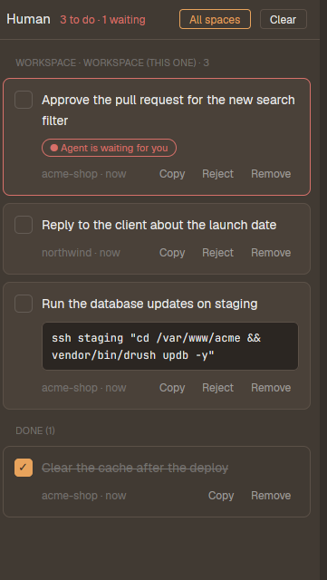

# Herdr Human

A checklist of what your agents ask *you* to do. A column (or a pane, or a popup) lists each
instruction as a card; you tick it off, copy its command with a click, or reject it so the
agent tries to do it itself. Agents add cards with a small command, `human-add`.

## What you see

A column about 360 px wide, `surface` background, top to bottom:

- **Header**, 44 px, a bottom border. "Human" (15 px, semibold), then a count in `blocked`
  red, 12 px, truncated if narrow: `3 to do · 1 waiting`, or `nothing to do` in `dim`. Then a
  scope button, `All spaces` (accent border) or `This space`, and `Clear` when something is
  done. In a window or popup there is also a `✕`.
- **The list**, scrolling, 10 px padding, 8 px between cards. Cards are `raised`, 8 px
  corners, 1 px `border`, 12 px padding, 8 px between their parts:
  - A 20 px checkbox (5 px corners, 1.5 px `input` border; checked: `accent` fill, a `✓`)
    and the instruction, 14 px, wrapping.
  - If the item has a command: a box indented 30 px, `background` fill, 1 px border, 6 px
    corners, the command in the user's monospace font at 12 px.
  - If an agent waits: a pill, 20 px high, `blocked` border and text, 11 px semibold,
    "● Agent is waiting for you". The card's border turns `blocked` too.
  - If the agent registered it again after a rejection: "Agent could not: <reason>", 12 px,
    `blocked`, and a `blocked` border.
  - A footer row indented 30 px: `project · age` (12 px, `dim`, truncated; "now", "5 min",
    "2 h", "3 d") then text buttons `Copy`, `Reject`, `Remove` (12 px, `muted`, `hover`
    background on hover). `Reject` only on items that have a terminal, aren't checked and
    aren't a retry.
- With **All spaces**, open items are grouped under small uppercase section titles, one per
  space: `SPACE NAME · count` (the shown space first and marked `(this one)`, then the
  others in space order, items whose terminal is gone last under `NO SPACE`). Two spaces
  with the same name get their folder added.
- **Done (n)** at the bottom: the same cards on a `surface` background, text struck through
  and `dim`, without the command box.
- Empty: "Nothing to do. Instructions from agents show up here."

Open items an agent is waiting for come first; the rest are newest first.

## How it behaves

- Instructions come from `~/.config/herdr-app/human/inbox.jsonl`, one JSON object per line:
  `{"id","ts","project","text","cmd"?,"retry"?,"terminal"?,"wait"?}`. The mod never writes
  it. Lines that don't parse (half-written) and repeated ids are skipped. It follows the
  folder with `watchFolder`, so a new card appears when a line is appended.
- What you did is kept in `~/.config/herdr-app/human/state.json`:
  `{"done": {"<id>": "<iso time>"}, "removed": ["<id>"]}`. Every change re-reads the file
  first and writes with the old text as `expected`, so two copies of the mod don't lose each
  other's clicks; a stale write shows a notification and reloads.
- **Checkbox** toggles done. Checking an item with `wait: true` and a `terminal` runs
  `hc send <terminal> 'Done by the human: "<text>". Continue.'`. Unchecking sends nothing. If
  the send fails: a warning notification "The agent didn't get the news (<terminal>)".
- **Click the instruction or the command box, or `Copy`**: copies the command, or the text
  if there is no command, and shows a "Copied" notification. Tries `pbcopy`, `wl-copy`,
  `xclip -selection clipboard`, `xsel --clipboard --input` in turn; if none works,
  "No clipboard tool found".
- **Reject** runs `hc send <terminal> 'Rejected by the human: "<text>" (<cmd>). Do it
  yourself. Only if you cannot: human-add --retry '<why you could not>' '<text>'.'`. Only if
  that succeeds is the item removed (and a "Sent back to the agent" notification shown); if
  it fails, "No agent received it (<terminal>)" and the item stays.
- **Remove** hides an item for good. **Clear** removes every done item.
- The scope button toggles between all spaces and the shown space (the default is all).
  An item whose terminal is unknown or closed is shown in every space. The mod redraws
  when the focused space changes (checked every 1.5 s) and once a minute for the ages.

## Built from

- `mods/human/main.js`: one `View`. `mods/human/mod.json`: `{ "place": "none", "title":
  "Human", "overlay": { "kind": "popup", ... } }` (a popup for `mod.open:human`; in a layout
  it is a block). `mods/human/icon.svg`: a rounded square with a check, for a tab bar button.
- From `herdr`: `readTextFile`, `writeTextFile`, `watchFolder`, `appHome`, `exec`, `hc`,
  `notify`, `theme`, `settings` (font family), `agents`, `spaces`, `focused`, `props`,
  `closeOverlay`, `checking`. From `gpui-kit` and `gpui-base`: `View`, `div`, `v_flex`,
  `h_flex`. Only theme colors (`surface`, `raised`, `background`, `border`, `input`,
  `foreground`, `muted`, `dim`, `accent`, `accent_foreground`, `blocked`, `hover`).
- It runs programs: `sh -c 'printf %s "$1" | <clipboard tool>'` and `hc send`. It reads and
  writes only `~/.config/herdr-app/human/`. Its one network call is the daily update check
  (`update.js`, below).
- `mods/human/update.js` (from the Blueprint mod's update check): `mod.json` carries a
  `version`. At most once a day, one copy fetches
  `https://raw.githubusercontent.com/petertornstrand/herdr-app-human/main/mods/human/mod.json`
  and shares `{checked, latest, error, off}` in shared state under `human.update`; a failed
  request is retried after an hour. If `latest` is newer (dotted numbers, junk is never
  newer), a banner (`raised`, bottom border, 12 px `muted` text "Human X is out (you have
  Y).", an accent `Update` button) shows under the header. The button sends the focused
  agent a prompt to replace `mods/human` and the `human-add` script from the repo, run
  `herdr-app check` and report the changes; with no focused agent it explains how.
  `herdr-app do human.update-check-off` / `update-check-on` switch the check.
- `bin/human-add` (bash, needs `jq`):
  `human-add [--project NAME] [--cmd 'command'] [--retry 'why not'] [--wait] 'text'`. It
  writes one line with `id` (`<epoch>-<8 hex>`), `ts` (UTC, ISO), the project (default: the
  current folder's name), and `terminal` from `$HC_TERMINAL_ID`, in a single `>>` append.
- In a layout: a hidden block `{ "id": "human-panel", "type": "block", "hidden": true,
  "size": { "px": 360 }, "min": 280, "max": 700, "content": { "mod": "human" } }` next to the
  side panel, and a tab bar button that runs `layout.show` / `layout.hide` with that id.

## Watch out

- Herdr's own layouts and tab bar are read-only; the button needs a cloned tab bar and layout
  (see the README).
- Dragging: in a floating window every control must stop its mouse-down or a click starts a
  drag. In a layout block this doesn't matter.
- `herdr-app check` writes `gpui-kit.d.ts` and `jsconfig.json` into the mod folder; they
  don't belong in a repo.
- Rejecting and `wait` only reach a terminal that still runs. The item stays otherwise.
- Don't overwrite `inbox.jsonl` by hand; agents append to it at any time.
- The mod does not know when an agent reads a message; it only knows the send worked.
- Not tried on macOS or Windows (`human-add` is a bash script; Windows is not supported).

## Done when

- `herdr-app check mods/human` passes.
- `human-add --project demo --cmd 'echo hi' 'Say hi'` makes a card appear within a second,
  with the command in a monospace box.
- Clicking the command copies exactly `echo hi`; the checkbox moves the card under Done and
  hides its command box; unchecking brings it back.
- `human-add --wait 'Approve it'` makes a red card with the pill, `1 waiting` in the header,
  and it sits above the other open cards.
- Checking a `--wait` card types `Done by the human: ...` into the terminal that registered
  it. `Reject` types the rejection text into it and removes the card.
- `Remove` and `Clear` survive a restart of the app; `inbox.jsonl` is unchanged.
